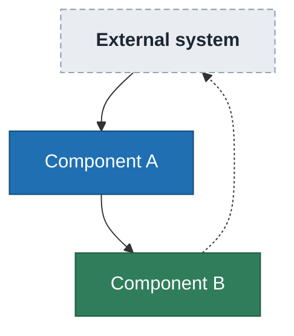

# {{Product}} Impact Assessment

**{{Product}} · Enterprise Architecture** · Status: **{{Draft | For review | Approved}}**

_The components {{Product}} introduces, the systems and platforms it depends on, and the regulatory, data and delivery impact of building it._

<!--
HOW TO USE THIS TEMPLATE
Replace every {{placeholder}}. Delete guidance comments before publishing.

Inputs (by role):
- Requirements: PRD (FR-, NFR-, NQ-, OQ-)                                   [required]
- Current state: Enterprise Architecture KB / service catalogue / CMDB /
  as-built architecture (Built, Live, Available items only)                 [required, or declare greenfield]
- Standards and constraints: Enterprise Architecture KB                     [required]
- Data and security policy: Security Standards KB                           [required]
- Phasing and SLAs: vision.md, nfr-spec.md                                  [optional]

Rules:
- Never use target architecture or new-design documents as current-state inputs.
- Any value no input supports is written as TBD, never guessed.
- Record "none found", not "none", when a check rests on incomplete sources.
-->

---

## 1. Purpose and Scope

> **PURPOSE**
> This document assesses the impact of delivering {{Product}}'s product requirements. It identifies **which components must be built and how far a failure in each would spread**, **which existing systems, platforms and external parties are affected or relied on**, **what new data the product introduces and how it is classified**, and **which regulatory obligations shape the design**. It informs architecture, backlog and planning decisions; it does not make them.

> [!IMPORTANT]
> **KEY ASSESSMENT ASSUMPTION**
> {{State the current-state basis: the source used for existing systems (EA KB, catalogue, CMDB, as-built architecture), or "greenfield confirmed", or "checks not possible because &lt;source&gt; was empty/missing". State what must be confirmed and what is reassessed if it turns out wrong.}}

### What this document covers

#### In scope

- **Components** required by each requirement, and their blast radius.
- **Existing-system impact** and duplicate-build risk.
- **Non-functional and regulatory impact**.
- **New data** and its classification.
- **Integrations, platform dependencies** and the critical path.

#### Not attempted here

- **Solution design** and technology selection.
- **Effort estimates**, held in the prioritised backlog.
- **Delivery schedule**, held in the feature cycle plan.
- **Legal opinion** on regulatory obligations.

> **READING THIS DOCUMENT**
> **Section 2** summarises the assessment · **Section 3** covers existing systems · **Section 4** lists the components and their blast radius · **Section 5** the non-functional and regulatory impact · **Section 6** the data impact · **Section 7** integrations, dependencies and the critical path · **Section 8** assumptions, risks and scope · **Section 9** findings and recommended actions. Requirements are referred to by key (FR-, NFR-, NQ-), obligations by CON-, risks by OR- and assessment actions by IA-.

---

## Document Control and Contents

_Identity, ownership and approval of this document, and how it is organised._

| Attribute | Value |
|---|---|
| **Document ID** | {{PREFIX}}-IA-001 · version {{x.y}} |
| **Document type** | Impact assessment |
| **Product** | {{Product}} |
| **Owner** | Enterprise Architect |
| **Approver** | {{Name}} |
| **Change control** | Reassessed when the requirements change materially, or when {{current-state source}} changes |
| **Classification** | {{Internal}} |

### Approvals

| Role | Responsibility | Signature | Date |
|---|---|---|---|
| **{{Approver}}** | Approver | | |
| **Enterprise Architect** | Owner of the assessment | | |
| **Product Owner** | Reviewer; requirement mapping | | |
| **Platform Lead** | Reviewer; platform dependencies | | |
| **Legal and Compliance** | Reviewer; regulatory impact | | |

### Version history

| Version | Date | Author | Change |
|---|---|---|---|
| {{0.1}} | {{YYYY-MM-DD}} | {{Name}} | Initial draft |

### How to read the tags

| Tag | Meaning |
|---|---|
| **High** | A failure cascades across the product or breaches an obligation. |
| **Medium** | A failure is contained to one user group or domain. |
| **Low** | A failure has no operational effect. |
| **MVP** | Needed for the minimum viable product. |
| **Rollout** | Needed for the rollout release. |
| **Added** | Identified by this assessment rather than named in the requirements. |

### Contents

- [1. Purpose and Scope](#1-purpose-and-scope)
- [Document Control and Contents](#document-control-and-contents)
- [2. Assessment Summary](#2-assessment-summary)
- [3. Existing-System Impact](#3-existing-system-impact)
- [4. Components and Blast Radius](#4-components-and-blast-radius)
- [5. Non-Functional and Regulatory Impact](#5-non-functional-and-regulatory-impact)
- [6. Data Impact](#6-data-impact)
- [7. Integrations and Dependencies](#7-integrations-and-dependencies)
- [8. Assumptions, Risks and Scope](#8-assumptions-risks-and-scope)
- [9. Findings and Recommended Actions](#9-findings-and-recommended-actions)

---

## 2. Assessment Summary

_The overall impact of {{Product}}, and what drives it._

> [!WARNING]
> **OVERALL IMPACT · {{HIGH | MEDIUM | LOW}}**
> {{Product}} introduces **{{n}} new components**, of which **{{n}} carry a high blast radius**. {{Name the foundation components others rely on, and why a failure cascades.}} {{Name the open risks that leave parts of the boundary undefined.}}

| Measure | Count | Detail |
|---|:---:|---|
| **New components** | **{{n}}** | {{n}} needed for the MVP; {{n}} only in the rollout release |
| **High blast radius** | **{{n}}** | {{Where they are concentrated}} |
| **Existing systems impacted** | **{{n}}** | {{Source; confirmed or to be confirmed}} |
| **External dependencies** | **{{n}}** | {{n}} external systems, {{n}} platform services, {{n}} regulatory frameworks |

### Flags

| Key | Flag | Why it matters |
|---|---|---|
| **FL-01** | {{Flag}} | {{Consequence for the assessment or the build}} |
| **FL-02** | {{Flag}} | {{Consequence for the assessment or the build}} |

---

## 3. Existing-System Impact

_Which existing services and configuration items {{Product}} overlaps with or changes._

| Check | Source | Result | Note |
|---|---|---|---|
| **Capability overlap (duplicate-build risk)** | {{Service catalogue / EA KB}} | **{{None found / Overlap / Not possible}}** | {{Capabilities checked; overlaps found}} |
| **Technical impact on configuration items** | {{CMDB / EA KB}} | **{{None / Changed / Not possible}}** | {{Systems changed and how; read-only vs write}} |
| **Systems excluded by an architecture decision** | {{EA KB}} | {{None / list}} | {{Why each is excluded}} |

> **WHY THIS MATTERS**
> {{What the result means for the build. Record "none found", not "none", when the check rests on incomplete sources. Name existing systems the product integrates with rather than replaces (Section 7).}}

---

## 4. Components and Blast Radius

_The new components each requirement needs, and how far a failure in each would spread._

| Component | Requirements | Release | Blast radius | Rationale |
|---|---|---|---|---|
| **{{Component}}** | {{FR-xxx}} | {{MVP / Rollout}} | **{{High / Medium / Low}}** | {{What fails, and how far it spreads}} |
| **{{Component}}** `Added` | {{FR-xxx; reason}} | {{MVP / Rollout}} | **{{High / Medium / Low}}** | {{Why the requirements need it}} |

{{Note any cross-cutting requirement (e.g. security safeguards) met by the platform baseline in Section 7.}}

---

## 5. Non-Functional and Regulatory Impact

_Performance, retention and regulatory constraints the components must respect._

### Performance and service levels

{{Agreed targets (NFR-, with values). Targets still to be set (NQ-). Whether SLOs can be defined, and whether enterprise standards make them a pre-production gate.}}

| Key | Target | Value | Status |
|---|---|---|---|
| **{{NFR-xxx}}** | {{Metric}} | {{Value or TBD}} | {{Agreed / Open (NQ-xxx)}} |

### Retention

> [!CAUTION]
> **{{A TENSION THE DESIGN MUST RESOLVE | RETENTION POSITION}}**
> {{Retention requirements and their sources; any conflict between them, and which components must apply a single policy.}}

### Regulatory boundaries

| Key | Obligation | Components constrained | Gate |
|---|---|---|---|
| **CON-01** | {{Regulation or obligation}} | {{Components}} | {{MVP / Rollout; condition}} |
| **CON-02** | {{Regulation or obligation}} | {{Components}} | {{MVP / Rollout; condition}} |

---

## 6. Data Impact

_The new data each component introduces, and how it is classified._

| Component | New records | Key attributes | Classification |
|---|---|---|---|
| **{{Component}}** | {{Record}} | {{Attributes; immutability or handling notes}} | **{{Class from security KB}}** |

> **DATA GOVERNANCE**
> {{Schema registration, data catalogue, classification handling, encryption, access control and data-loss controls required by the enterprise and security standards. Data boundaries with existing systems of record.}}

---

## 7. Integrations and Dependencies

_What {{Product}} relies on, what relies on it, and the longest chains of dependency._

_**FIGURE 1** · Component dependency graph. Blue: MVP. Green: rollout release. Dashed: external. Arrows run from the component supplying data to the component that depends on it. {{Cross-cutting components omitted for legibility.}}_

### External systems

| System | Direction | Components | Note |
|---|---|---|---|
| **{{System}}** | {{Upstream / Downstream / Peer / Excluded}} | {{Components}} | {{Read-only, outbound only, assumption key, open item}} |

### Platform services required by enterprise standards

| Service | Components that depend on it | In requirements? |
|---|---|---|
| **{{Service}}** | {{Components}} | **{{Yes / Added}}** |

{{Whether these are provided by the enterprise platform baseline or must be provisioned (assumption key). Regulatory frameworks treated as dependencies of which components.}}

### Critical paths

| Key | Path | Length |
|---|---|---|
| **CP-01** | {{A → B → C}} | {{n}} steps |

{{Which path is the core value chain, its release, and how many of its components carry a high blast radius.}}

---

## 8. Assumptions, Risks and Scope

_What the assessment takes for granted, the risks that bear on it, and what it leaves out._

### Assumptions

| Key | Assumption |
|---|---|
| **AS-01** | {{Assumption}} |

### Risks bearing on this assessment

| Key | Risk | Impact on components |
|---|---|---|
| **OR-01** | {{Risk}} | {{Components affected}} |

### Out of scope

- {{Item}}: {{reason or condition}}.

---

## 9. Findings and Recommended Actions

_What the assessment concludes, and what should happen next._

| Key | Action | Owner | Before |
|---|---|---|---|
| **IA-01** | {{Action}} | {{Role}} | {{Architecture sign-off / MVP design / MVP build / Rollout design}} |

> [!NOTE]
> **BOTTOM-LINE POSITION**
> {{One paragraph: the nature of the product (greenfield or change to existing estate), the size and concentration of impact, which parts must be most resilient, and which open decisions must close before build.}}

| Question | Answer |
|---|---|
| **Does {{Product}} change any existing system?** | {{Answer, with basis and action key}} |
| **Where is the highest risk?** | {{Answer}} |
| **What does {{Product}} need that it will not build?** | {{Answer}} |
| **What must be decided before build?** | {{Answer}} |
